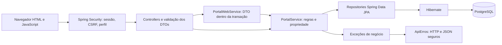
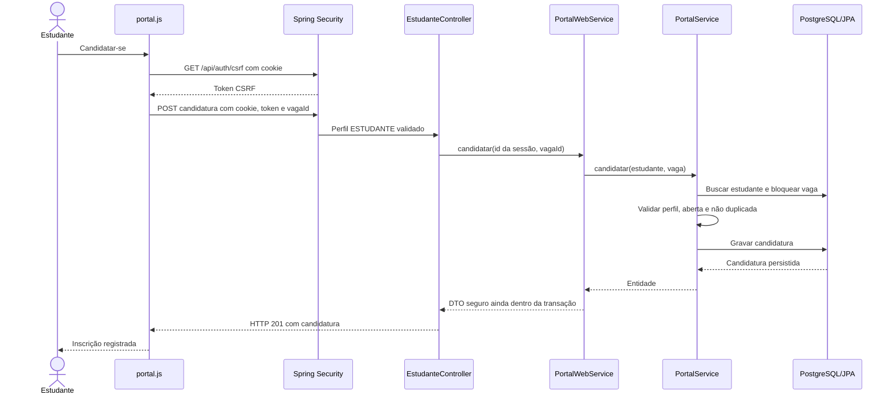

# Arquitetura da Entrega 2

As dependências são recebidas por construtor. Model contém entidades e enums; service coordena regras e transações; repository concentra persistência; controller recebe entradas HTTP e usa a identidade autenticada. DTOs selecionam os dados expostos. O HTML não tem SQL e os repositories não decidem perfil/propriedade.

O bloqueio de linha da vaga coordena candidatura, edição e encerramento. A restrição UNIQUE do par estudante-vaga reforça a unicidade. Consultas próprias sempre usam a sessão; IDs enviados pelo cliente não definem o proprietário. O serviço verifica propriedade mesmo após a autorização por perfil.

Migração: o console/JDBC da Entrega 1 foi preservado como histórico e evoluído para JPA. O console legado ainda pode executar as regras, mas a identidade simulada não faz parte da autenticação da Entrega 2. Não há JWT obrigatório, SPA, chat, gráficos ou integrações externas; a interface mínima usa HTML/JavaScript, como permitido no enunciado.
