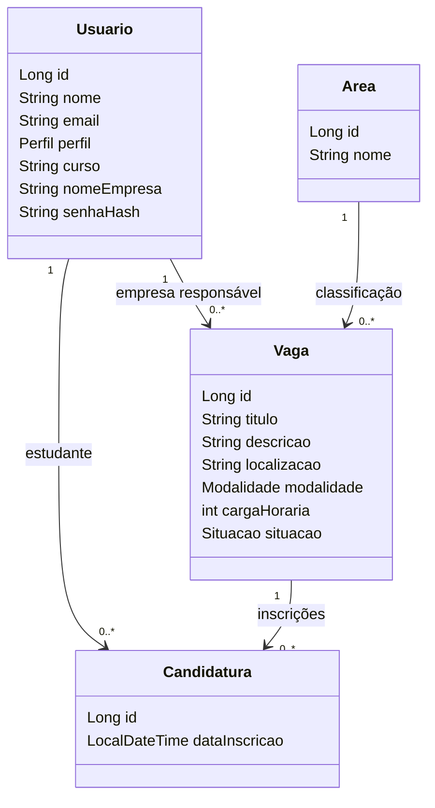
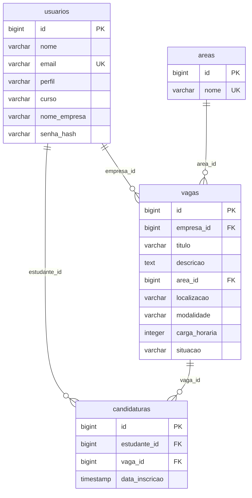

# Modelo de domínio e esquema — Entrega 2

O perfil restringe o papel do usuário: empresa possui nomeEmpresa, estudante possui curso, administrador não possui os dois. Não é necessária herança por perfil. Uma candidatura representa a associação entre estudante e vaga e guarda sua própria data em UTC. Encerrar uma vaga preserva as inscrições.

Restrições adicionais: UNIQUE(estudante_id, vaga_id); carga_horaria positiva; enum de perfis, modalidades e situações; área usada tem exclusão restringida pela FK; e-mail e nome de área únicos. senha_hash é nullable para preservar contas antigas, mas contas sem hash válido não autenticam. O hash tem 60 caracteres BCrypt e nunca é exposto nos DTOs.

O esquema é criado por sql/01_criacao.sql e recebe senha_hash por sql/03_hash_senha.sql. As entidades @ManyToOne usam as chaves estrangeiras existentes. As regras de perfil e propriedade são do serviço, além das restrições do banco e das autorizações HTTP.
